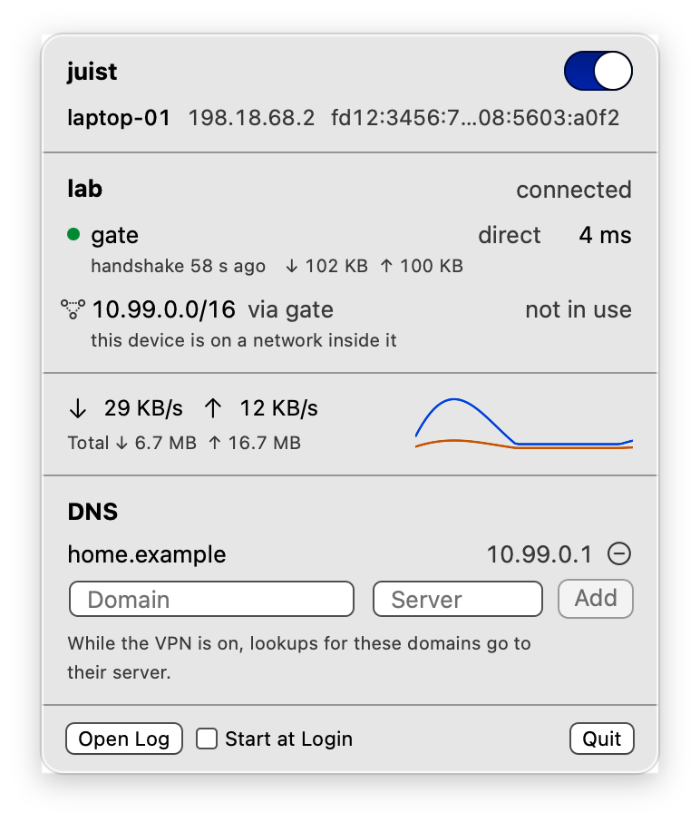

# Priel

A menu bar app for [juist](https://github.com/nning/juist) on the Mac, and an OPNsense plugin
for the firewall end. juist is a peer-to-peer WireGuard mesh VPN with no coordination server.

<picture>
  <source media="(prefers-color-scheme: dark)" srcset="site/img/window-connected-dark.png">
  
</picture>

I wanted juist on my laptop without two shell scripts and a sudo prompt every time I turned it
off, and I wanted to see whether the tunnel to home was actually up. This is that.

## Install

### Mac

macOS 14 or later, Apple silicon or Intel.

```sh
brew tap 0x23me/tap
brew trust --cask 0x23me/tap/priel
brew install --cask 0x23me/tap/priel
```

Or grab `Priel-VERSION.zip` from [releases](../../releases), unzip, move Priel to Applications.
Signed and notarized.

### OPNsense

OPNsense 26.7 or later (FreeBSD 15), amd64 or arm64.

Two pkg repositories, once: juist's own (for juist) and Priel's (for the plugin, which depends
on juist). As root on the firewall:

```sh
mkdir -p /usr/local/etc/pkg/keys
fetch -o /usr/local/etc/pkg/keys/juist.pub https://pkg.juist.nning.io/juist/freebsd.pub
fetch -o /usr/local/etc/pkg/keys/priel.pub https://0x23me.github.io/priel/opnsense/priel.pub
cat > /usr/local/etc/pkg/repos/priel.conf <<'EOF'
juist: { url: "https://pkg.juist.nning.io/juist/freebsd/${ABI}", signature_type: "pubkey", pubkey: "/usr/local/etc/pkg/keys/juist.pub" }
priel: { url: "https://0x23me.github.io/priel/opnsense/${ABI}", signature_type: "pubkey", pubkey: "/usr/local/etc/pkg/keys/priel.pub" }
EOF
pkg update && pkg install os-juist
```

Key checksums (`sha256 /usr/local/etc/pkg/keys/*.pub`): juist's is
`c649f2cd073f9e72825b0c1b8a2682f25c5c55405a178ea6d8a0f8b65ed89e3d` (from juist's install docs),
Priel's is `092493a223800ae06b56630efc2483b59eb3331fa43d7fd6b2dd26708655121b`.

## Use

### Mac

1. Flip the switch. The first time, and again after each Priel update, it asks for your
   password: that copies juistd and two small scripts into
   `/Library/PrivilegedHelperTools/me.0x23.priel`, owned by root, checks they carry Priel's
   signature, makes the hidden user `_juist` that juistd runs as, and installs a LaunchDaemon
   that runs them. After that the switch needs nothing.
2. Paste an invite code from `juist invite` on a device that's already in the network.
   Joining also makes you this Mac's juist operator, which is what shows device names and
   latency.
3. If you want the `juist` command too, hit Install. It links `/usr/local/bin/juist` to the
   root-owned copy.

Off means juistd is stopped and stays stopped across reboots. On means it starts at boot,
before anyone logs in. Quitting Priel doesn't touch juistd.

### OPNsense

The plugin is under VPN › juist and should be listed under System › Firmware › Plugins; it
updates with the firewall.

## More

- [Priel on the Mac](docs/mac.md): what runs as root and why, juistd's flags, taking over
  from juist's own installer, split DNS, removing it, the bundled juist.
- [What the plugin changes on OPNsense](opnsense/README.md).
- [Building the Mac app](mac/README.md).

## State of things

Early. It runs on one Mac and one OPNsense box, mine. Expect rough edges and tell me about them.

## Credits

- [juist](https://github.com/nning/juist) by henning mueller. Bugs in Priel go [here](../../issues).
- The bundled juist and juistd are built from [0x23me/juist](https://github.com/0x23me/juist),
  juist plus one commit on the `priel` branch.

## License

BSD-3-Clause, same as juist. What's taken from juist is listed in
[THIRD_PARTY.md](THIRD_PARTY.md).
