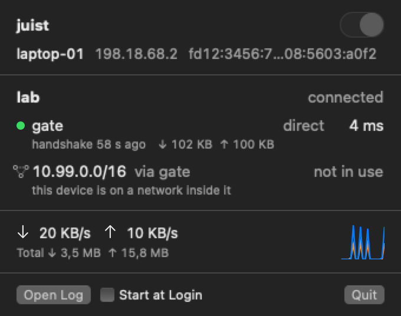

# Priel

A menu bar app for [juist](https://github.com/nning/juist) on the Mac, and an OPNsense plugin
for the firewall end. juist is a peer-to-peer WireGuard mesh VPN with no coordination server.

I wanted juist on my laptop without two shell scripts and a sudo prompt every time I turned it
off, and I wanted to see whether the tunnel to home was actually up. This is that.

Priel is not part of juist and not made by its author. If something breaks, open an issue
[here](../../issues), not on juist.

(A priel is a tidal channel in the mud flats. Juist is an island with plenty of them.)

## Mac



```sh
brew tap 0x23me/tap
brew trust --cask 0x23me/tap/priel
brew install --cask 0x23me/tap/priel
```

Or grab `Priel-VERSION.zip` from [releases](../../releases), unzip, move Priel to Applications.
Signed and notarized. macOS 14 or later, Apple silicon or Intel.

1. Flip the switch. The first time, and again after each Priel update, it asks for your
   password: that copies juistd and two small scripts into
   `/Library/PrivilegedHelperTools/me.0x23.priel`, owned by root, checks they carry Priel's
   signature, makes the hidden user `_juist` that juistd runs as, and installs a LaunchDaemon
   that runs them. After that the switch needs nothing.
2. Paste an invite code from `juist invite` on a device that's already in the network.
   Joining also makes you this Mac's juist operator, which is what shows device names and
   latency.
3. If you want the `juist` command too, hit Install. It links `/usr/local/bin/juist` to the
   root-owned copy.

Off means juistd is stopped and stays stopped across reboots. On means it starts at boot,
before anyone logs in. Quitting Priel doesn't touch juistd. The switch is the file
`/Library/Application Support/Priel/on`; the daemon starts juistd while it exists.

Why the copy: anything inside an app in `/Applications` can be rewritten by your user, and
root running it would hand root to anything running as you.

juistd starts as root with `--home /var/db/juist --socket /var/run/juist/juistd.sock`, keeps a
small helper as root for the tunnel (`utun100`), its addresses and routes, and runs the rest as
`_juist`, which owns `/var/db/juist`. Anything else goes in `/etc/priel/juistd.flags`, which has
to be owned by root (otherwise it's ignored):

```sh
sudo mkdir -p /etc/priel
echo "--no-dht --no-stun" | sudo tee /etc/priel/juistd.flags
```

Flip the switch off and on to pick it up.

### If juist's own installer was here first

`curl -fsSL https://juist.nning.io/install | sh` sets juist up with the same user and the same
`/var/db/juist`, so this Mac stays the same device when Priel takes over: Priel's password step
stops and disables juist's LaunchDaemon (`io.nning.juist.juistd`) and runs its own instead.
Running juist's installer again leaves it disabled; `brew uninstall --zap priel` turns it back on.
Other networks you started with juist's `setup.sh instance start` keep running as they are.

### Split DNS

If your network has internal domains, the DNS section sends their lookups to a server on the
other side: `b.home.example` to 10.23.1.1, say. It uses `/etc/resolver`, one file per domain,
written when juistd starts and removed when it stops, so with the VPN off nothing hangs on a
server you can't reach. Priel only removes files it wrote. If you already made some by hand
that point into a juist subnet, Take Over adopts them. The list lives in
`/etc/priel/resolvers`.

### Removing it

Installed with Homebrew: `brew uninstall --zap priel`. A plain `brew uninstall` leaves juistd
running: Homebrew runs a cask's uninstall steps on every upgrade too, and the VPN would drop.
Otherwise:

```sh
sudo launchctl bootout system/me.0x23.priel.juistd
sudo rm -rf /Library/LaunchDaemons/me.0x23.priel.juistd.plist /Library/PrivilegedHelperTools/me.0x23.priel \
  "/Library/Application Support/Priel" /etc/priel /usr/local/bin/juist
```

`/var/db/juist` holds this Mac's keys in the network, owned by the `_juist` user. If you're done
with juist, delete both:

```sh
sudo rm -rf /var/db/juist
sudo dscl . -delete /Users/_juist; sudo dscl . -delete /Groups/_juist
```

The bundled juist comes from [0x23me/juist](https://github.com/0x23me/juist), juist plus one
small commit on the `priel` branch: it leaves a juist subnet out of the tunnel while the Mac
sits on a network inside that subnet, so at home your LAN stays direct. That is my policy, not a
safe default: any network numbered inside the subnet gets the same treatment. Everything else
the app shows, each peer's last handshake and, to the operator, its byte counts, is juist's own.
Building it yourself: [mac/README.md](mac/README.md).

## OPNsense

Two pkg repositories, once: juist's own (for juist) and Priel's (for the plugin, which depends
on juist). As root on the firewall:

```sh
mkdir -p /usr/local/etc/pkg/keys
fetch -o /usr/local/etc/pkg/keys/juist.pub https://pkg.juist.nning.io/juist/freebsd.pub
fetch -o /usr/local/etc/pkg/keys/priel.pub https://0x23me.github.io/priel/opnsense/priel.pub
cat > /usr/local/etc/pkg/repos/priel.conf <<'EOF'
juist: { url: "https://pkg.juist.nning.io/juist/freebsd/${ABI}", signature_type: "pubkey", pubkey: "/usr/local/etc/pkg/keys/juist.pub" }
priel: { url: "https://0x23me.github.io/priel/opnsense/${ABI}", signature_type: "pubkey", pubkey: "/usr/local/etc/pkg/keys/priel.pub" }
EOF
pkg update && pkg install os-juist
```

Key checksums (`sha256 /usr/local/etc/pkg/keys/*.pub`): juist's is
`c649f2cd073f9e72825b0c1b8a2682f25c5c55405a178ea6d8a0f8b65ed89e3d` (from juist's install docs),
Priel's is `092493a223800ae06b56630efc2483b59eb3331fa43d7fd6b2dd26708655121b`.

After that the plugin is under VPN › juist and should be listed under System › Firmware ›
Plugins; it updates with the firewall. OPNsense 26.7 or later (FreeBSD 15), amd64 or arm64. What it changes
on the box: [opnsense/README.md](opnsense/README.md).

## State of things

Early. It runs on one Mac and one OPNsense box, mine. Expect rough edges and tell me about them.

## License

BSD-3-Clause, same as juist. What's taken from juist is listed in
[THIRD_PARTY.md](THIRD_PARTY.md).
